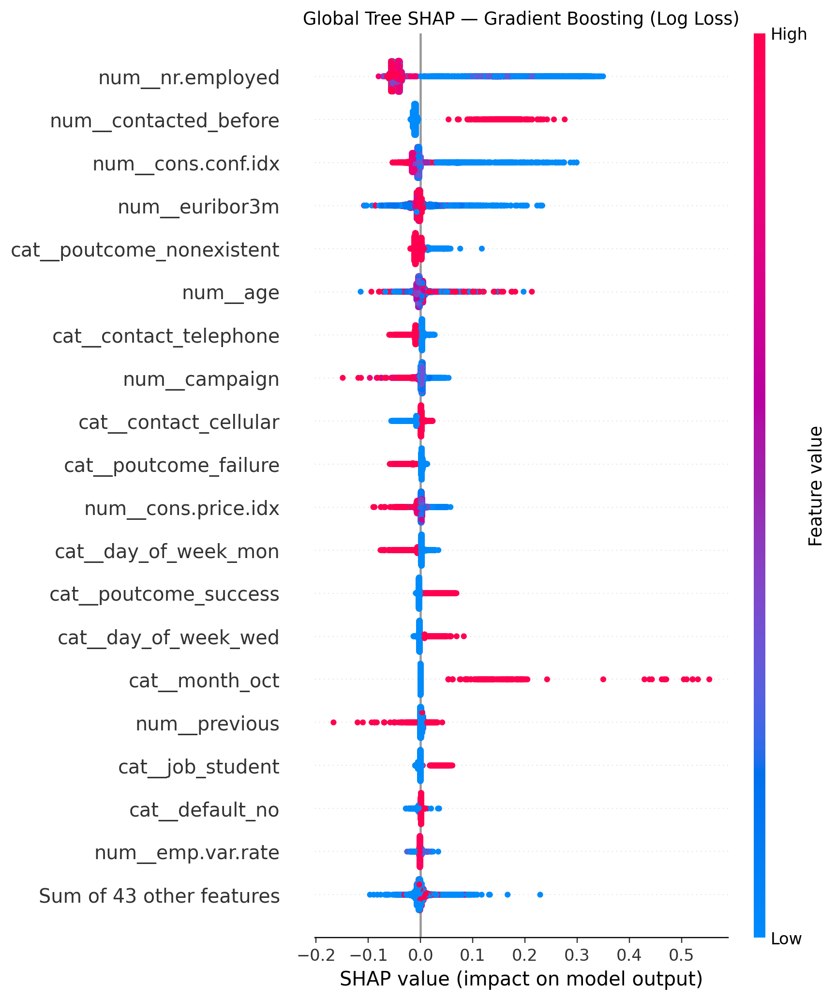
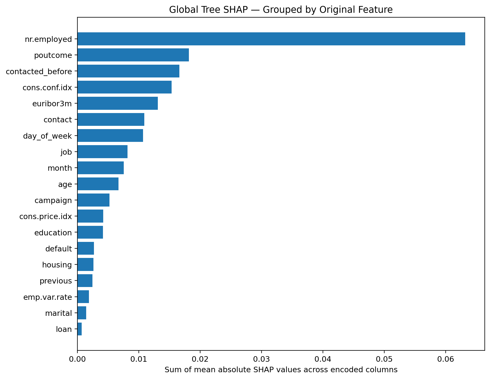
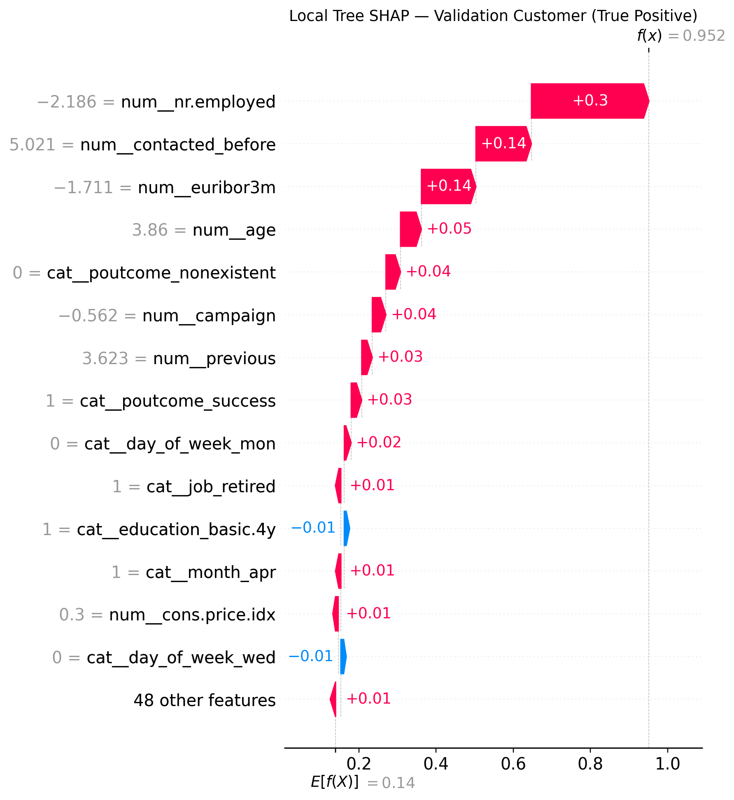

# SHAP Analysis: Global and Local Tree SHAP

## 1. Overview

This section presents the interpretability analysis of the selected Gradient Boosting model trained with Logistic Loss.

The objective is to understand how different customer characteristics, previous campaign information, and macroeconomic indicators influence the model's predictions of term deposit subscription.

We apply Tree SHAP to provide two levels of model interpretability:

- **Global SHAP:** Identifies the most influential features across the validation dataset.
- **Local SHAP:** Explains how individual features contribute to the prediction for a specific customer.

The analysis helps translate model predictions into interpretable business insights for bank marketing campaigns.

## 2. Selected Model and SHAP Methodology

The selected model is:

| Item | Description |
|---|---|
| Model | GradientBoostingClassifier |
| Objective | Log Loss |
| Validation AUC | 0.806048 |
| Dataset | Bank Marketing |
| Target Variable | y (Term Deposit Subscription) |
| SHAP Method | Tree SHAP |

**Important:** The implementation uses Scikit-learn's `GradientBoostingClassifier`, rather than XGBoost's `XGBClassifier`.

Tree SHAP was applied to the trained tree-based model without retraining it.

The analysis uses the same preprocessing pipeline as the original model to ensure consistency between model predictions and SHAP explanations.

## 3. Global Tree SHAP Analysis

### 3.1 Objective

Global SHAP examines feature contributions across the validation dataset to identify which variables have the greatest influence on the model's predictions.

Mean Absolute SHAP Value is used to measure the average magnitude of each feature's contribution.

A higher value indicates greater influence on model predictions, regardless of whether the influence is positive or negative.

### 3.2 Global Feature Importance

The SHAP beeswarm plot illustrates:

- The distribution of SHAP values across observations.
- The direction in which feature values influence predictions.
- The relative importance of individual features.

The main findings are:

1. **Macroeconomic indicators:** `nr.employed` is the most influential feature in the model, suggesting that employment-related economic conditions play a substantial role in the model's predictions.

2. **Previous campaign outcomes:** `poutcome` and previous contact information are important predictors, indicating that historical marketing interactions provide useful predictive information.

3. **Economic environment:** Variables such as `cons.conf.idx` and `euribor3m` also contribute to the model's predictions.

### 3.3 Aggregated Feature Importance

Since categorical variables are transformed through One-Hot Encoding, individual original variables may be represented by multiple encoded features.

To improve business interpretability, encoded feature contributions are aggregated back to their original feature groups.

The resulting feature importance ranking highlights the importance of:

- Macroeconomic conditions.
- Previous campaign outcomes.
- Customer contact history.
- Contact channels.
- Customer characteristics.

The bar chart provides a more business-oriented interpretation of the model than the encoded feature ranking alone.

## 4. Local Tree SHAP Analysis

### 4.1 Objective

While Global SHAP explains the overall behaviour of the model, Local SHAP explains an individual prediction.

We select an anonymised customer from the validation dataset to examine how the model arrives at its prediction.

### 4.2 Selected Customer

| Attribute | Value |
|---|---|
| Actual Outcome | Yes |
| Predicted Probability | 95.16% |
| Predicted Outcome | Yes |
| Age | 80 |
| Job | Retired |
| Marital Status | Divorced |
| Education | Basic 4y |
| Contact | Cellular |
| Previous Campaign Outcome | Success |

### 4.3 Local Feature Contributions

The waterfall plot illustrates how individual features move the model prediction away from its baseline value.

The selected customer's prediction can be summarised as:

- Base Value: 13.96%
- Combined SHAP Contributions: +81.20 percentage points
- Final Predicted Probability: 95.16%

The most influential positive contributions include:

| Feature | SHAP Contribution |
|---|---:|
| nr.employed | +0.3046 |
| contacted_before | +0.1438 |
| euribor3m | +0.1413 |
| poutcome | +0.0714 |
| age | +0.0541 |
| campaign | +0.0353 |
| previous | +0.0274 |

These values represent contributions to this customer's model prediction, rather than causal effects on actual subscription behaviour.

## 5. Business Implications

The SHAP analysis provides several potential implications for bank marketing strategy.

**1. Incorporating Macroeconomic Conditions**

The strong contribution of `nr.employed` and other economic indicators suggests that marketing response predictions are closely associated with the economic environment.

Banks may consider incorporating macroeconomic conditions into campaign planning and periodically reviewing model performance as economic conditions change.

**2. Leveraging Historical Campaign Information**

Features such as `poutcome` and previous contact information are influential predictors.

Historical campaign records can therefore help banks prioritise customers for future marketing activities.

**3. Supporting More Explainable Customer Prioritisation**

Local SHAP provides explanations for individual predictions.

This enables marketing teams to understand which customer characteristics contribute to a higher predicted subscription probability, supporting more transparent campaign prioritisation.

## 6. Model Limitations

Despite its predictive performance on the random validation set, several limitations should be considered.

**1. Temporal Generalisation**

The model achieves a random validation AUC of 0.806048, but its performance deteriorates substantially under time-based validation.

This suggests that the learned relationships may not remain stable across different time periods.

**2. Dependence on Macroeconomic Indicators**

The strong importance of `nr.employed` suggests that the model relies heavily on macroeconomic information.

Changes in economic conditions may therefore affect future prediction performance.

**3. Historical Dataset Limitations**

The dataset originates from a Portuguese bank's telemarketing campaigns conducted between 2008 and 2010. Its findings may not generalise directly to modern banking or FinTech environments.

**4. SHAP Does Not Establish Causality**

SHAP explains how features contribute to model predictions. It does not establish that changing a particular feature would cause a customer to subscribe.

**5. Prediction Does Not Equal Marketing Uplift**

A high predicted subscription probability does not necessarily mean that contacting a customer will increase their likelihood of subscribing.

Further causal or uplift analysis would be required to estimate the incremental impact of marketing interventions.

## 7. Conclusion

The Global and Local Tree SHAP analyses provide complementary perspectives on the selected Gradient Boosting model.

Global SHAP identifies macroeconomic indicators and historical campaign information as important predictors, while Local SHAP demonstrates how these features contribute to an individual customer's prediction.

However, the substantial deterioration in time-based validation performance highlights the importance of temporal stability and continuous model monitoring.

Overall, SHAP improves the interpretability of the model and helps translate predictive outputs into actionable business insights, while its explanations should be interpreted as model associations rather than causal relationships.

## 8. Supplementary Visualisations

### Encoded Feature Importance

### Encoded Local Feature Contributions

