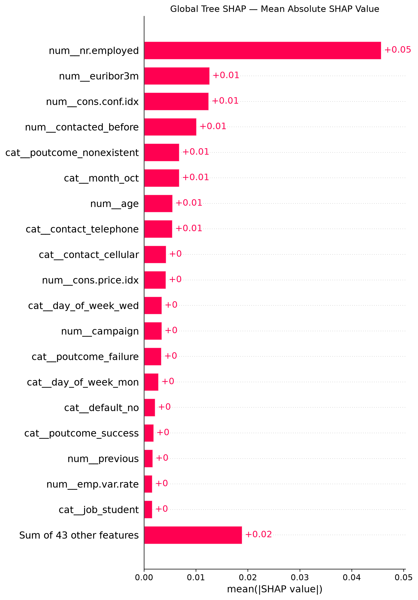
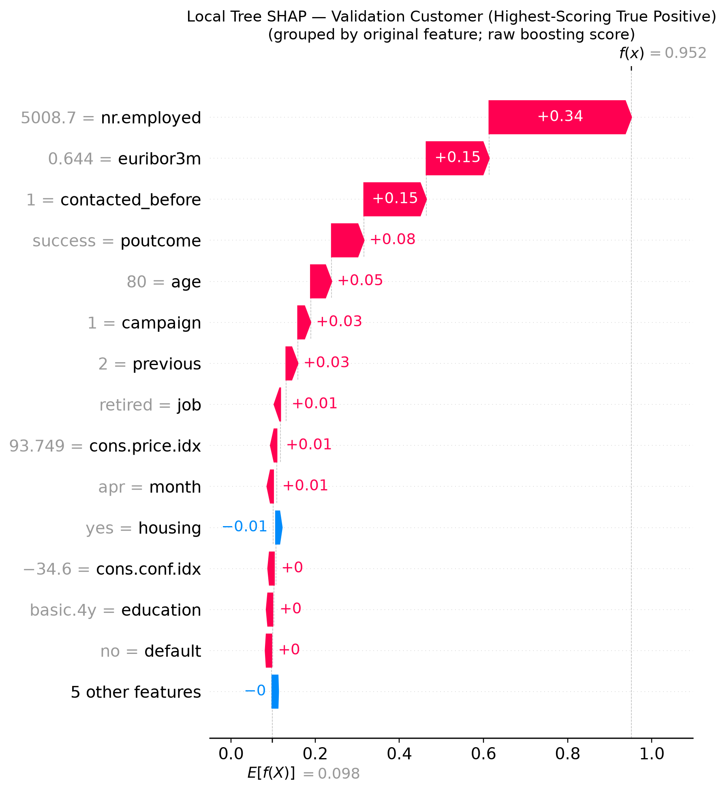
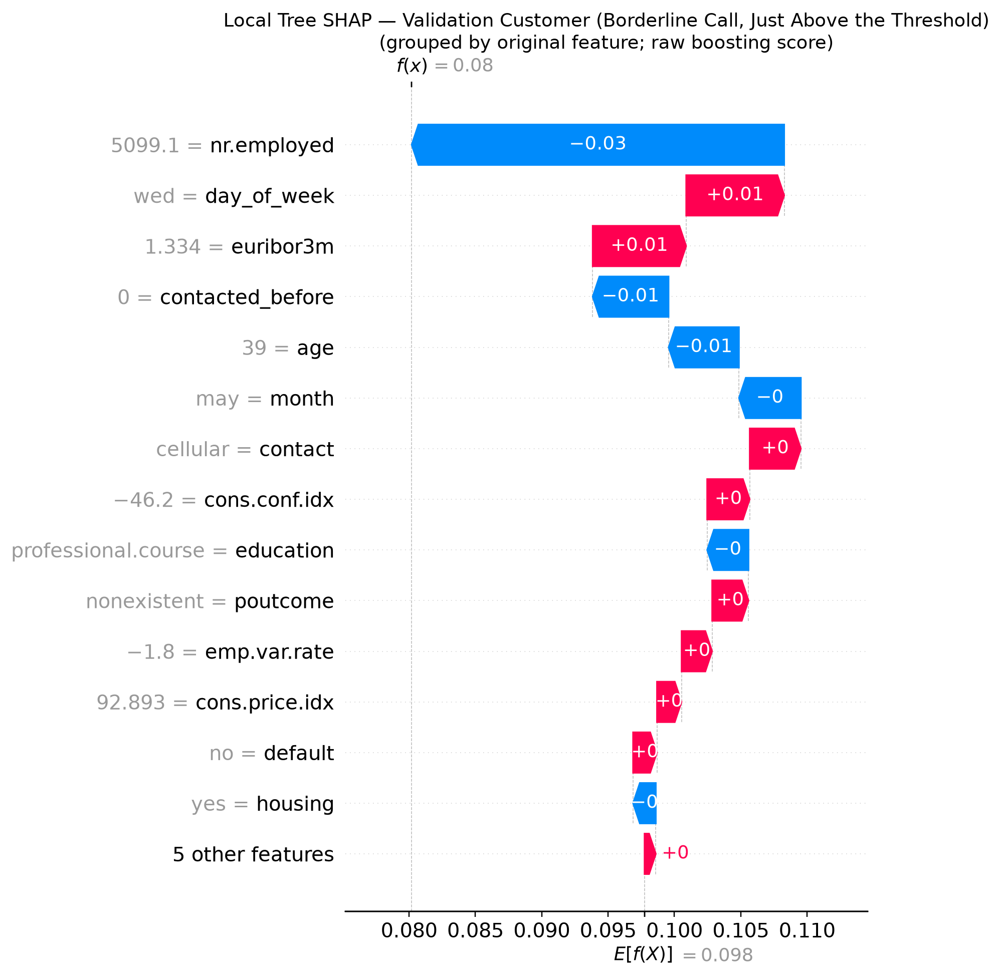

# SHAP figures

Created by `python notebooks/02_shap_analysis.py` (Tree SHAP on the selected Gradient Boosting (log loss) model,
1,000-row training background, 8,238 validation customers). The method, numbers and limitations are explained in
[`SHAP_INTERPRETABILITY.md`](../../SHAP_INTERPRETABILITY.md).

SHAP values add up to the model's **raw boosting score**. The final model turns that score into a calibrated
probability (isotonic) and calls a customer when it is at least 0.0825.

## Global SHAP

**Beeswarm** – direction and spread of each encoded feature's effect across validation customers.

**Grouped by original feature** – one-hot columns added up per customer, then mean |SHAP|.
The economic indicators rank highest; `nr.employed` mainly marks the time period (only 11 values), so it is a
drift risk rather than a business lever. Contact history and contact channel are the strongest customer-level predictors.

**Encoded features** – mean |SHAP| per one-hot column.

## Local SHAP

**Top case** – highest-scoring true positive (row 39498: 80, retired, previous campaign = success;
raw score 0.952, calibrated probability 1.00).

**Borderline case** – the called customer with the lowest score (row 31131: 39, blue-collar, never contacted before;
raw score 0.080, calibrated probability 0.083, just above the 0.0825 threshold; did not subscribe).

Encoded-feature versions: `local_tree_shap_waterfall.png`, `local_tree_shap_waterfall_borderline.png`.
